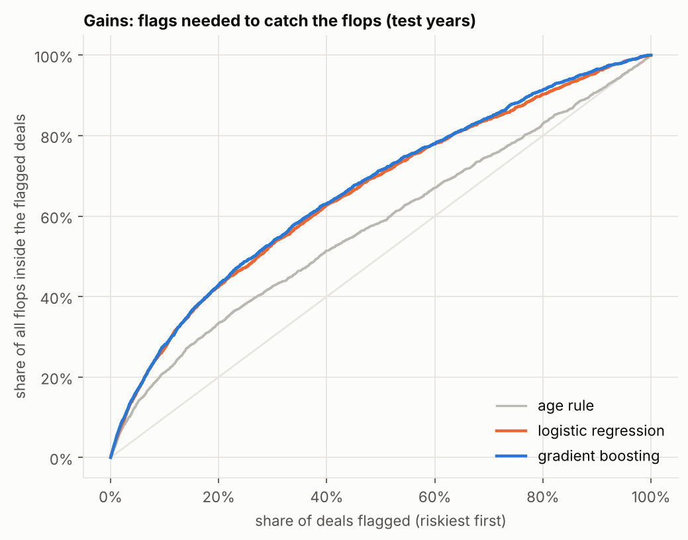

# Will this transfer flop? — a risk screen for sporting directors

AI Football Intelligence, Lab 2. Team: **<name 1>, <name 2>** (replace with your names).

Football clubs spend large sums on transfers that never turn into playing time. This project builds and **honestly
evaluates** a model that ranks permanent summer transfers by the risk that the player plays **less than 25 % of the new
club's league matches in his first season**, using only information available *before* the deal. A small Streamlit app
lets a sporting director score a deal and see what happened to similar ones.

| | |
|---|---|
| **Decision supported** | Which incoming transfers deserve a second opinion before signing? |
| **Data** | [salimt/football-datasets](https://github.com/salimt/football-datasets) (Transfermarkt scrape), pinned to commit `da9227e` |
| **Population** | 41,701 permanent summer transfers, 2012-2024, market value or fee known, moves inside one club excluded |
| **Flop rate** | 18.5 % overall (16 % in the 2022-24 test years) |
| **Result** | AUC **0.69** on untouched 2022-24 deals vs 0.59 for the best single rule (age) |

## The five stages

| Stage | What we did | Where |
|---|---|---|
| 1. Problem | One decision, one measurable outcome (`y_flop`), a 25 % playing-time threshold stated up front | notebook 01 |
| 2. Data | Download pinned data, audit it, build one row per transfer, record every filter in a population funnel | notebook 01 |
| 3. Analytics / AI | Nine written-down hypotheses tested with an adjusted logistic regression, then a gradient-boosted model | notebooks 02, 03 |
| 4. Quality checks | Leakage guards, time-based split, bootstrap intervals, shuffled labels, label-robustness, calibration, subgroup results | notebooks 01, 03 |
| 5. Decision | Gains table (flag the riskiest 10 % → 45 % of them flop vs 16 % overall) and the demo app | notebook 03, `app/` |

## Results in short

- **Beats simple rules clearly.** Test AUC 0.694 (95 % CI 0.681-0.707) for gradient boosting, 0.687 for logistic
  regression, 0.589 for the age rule, 0.5 for chance.
- **The complexity buys little.** Gradient boosting vs logistic regression: +0.007 AUC, interval touching 0. We say so
  in the notebook rather than hide it.
- **Works as a screen, not a verdict.** Flagging the riskiest 10 % of deals gives a 45 % flop rate against 16 %
  overall (lift 2.8) and catches 28 % of all flops.
- **Probabilities need recalibration.** The raw model predicts 22 % on average in 2022-24 when 16 % flopped (the flop
  rate fell over time); recalibrating on 2020-21 fixes the average.
- **Weaker for expensive deals.** The model mostly finds cheap, young signings; the flagged 10 % hold only about 5 %
  of the fee money.



## Pitfalls we analysed

1. **Confounding (goalkeepers).** Clubs with few established players at a position seem to flop *more*, which is the
   opposite of the intuition. The effect is created by goalkeepers (flop rate ~40 %). Split by position, the pattern
   nearly disappears (notebook 02, section 5).
2. **Small samples.** Club-level flop rates are mostly noise; a funnel plot shows it. We use structural club features
   (tier, strength, squad depth) rather than raw club flop rates, which would memorise noise and leak the label
   (notebook 02, section 6).
3. **Data leakage.** Every feature uses only data before the transfer date (previous seasons, `merge_asof` backward,
   injuries clipped at the transfer date), with assertions in notebook 01. A shuffled-label test returns AUC 0.50.
4. **A flawed population, found and fixed.** Our first version included players promoted inside one club
   (reserve team to first team). They flop often and were easy to flag, which flattered the model (AUC 0.72 instead of
   0.69). We found it by reading the model's highest-risk predictions, removed these rows and re-ran everything.
5. **Label sensitivity.** With a 15 % or 33 % threshold the AUC moves between 0.68 and 0.73; without zero-appearance
   rows it drops to 0.67 and the model ties with logistic regression.
6. **Drift.** The flop rate was 20 % in the training years and 16 % in the test years, so calibration matters.

## Repository structure

```
README.md
requirements.txt
notebooks/
  01_data_prep.ipynb          download, audit, population funnel, label, features, leakage checks
  02_eda.ipynb                hypotheses, adjusted model, confounding and small-sample traps
  03_model_evaluation.ipynb   baselines, model, evaluation, calibration, decision value, saved model
app/app.py                    Streamlit demo
data/processed/               transfers_model.csv.gz (model table), population_funnel.csv, columns.csv, test_predictions.csv.gz
models/flop_model.joblib      gradient-boosted model + calibrator, exactly as evaluated
reports/figures/              charts used in the notebooks and slides
reports/tables/               scorecard, test results, subgroup and robustness tables, metrics.json
```

## How to run

Python 3.10+.

```bash
pip install -r requirements.txt

# 1) Rebuild the data and the analysis (about 1 minute each; notebook 01 downloads the pinned dataset)
jupyter nbconvert --to notebook --execute --inplace notebooks/01_data_prep.ipynb
jupyter nbconvert --to notebook --execute --inplace notebooks/02_eda.ipynb
jupyter nbconvert --to notebook --execute --inplace notebooks/03_model_evaluation.ipynb

# 2) Start the demo
streamlit run app/app.py
```

The notebooks also run in Google Colab (run them in order; they download the data themselves). The saved model needs
`scikit-learn==1.9.1`, the version that created it; re-running notebook 03 recreates it for any version.

## The demo app

- **Score a transfer:** set position, age, market value, fee, last-season playing time, league levels and destination
  club context. It shows the calibrated risk, whether the deal is in the riskiest 10 % of 2022-24, what moves the
  risk, and the outcomes of the most similar past deals.
- **Check it on past deals:** browse the 2022-24 test deals, predicted risk next to what really happened.

## Limits

- **"Flop" is a proxy.** Under 25 % of matches cannot tell a bad signing from an injury, a squad-depth signing or a
  coach change. Minutes played are too incomplete in the source (missing in 62 % of rows) to use instead.
- **Association, not cause.** The model describes what usually goes with a flop, not what a club could change.
- **Scope.** Permanent summer transfers, one source (Transfermarkt), crowd-sourced values; not for loans, winter
  windows or leagues outside the data.
- **Modest accuracy.** AUC 0.69 is useful for screening; most flops stay unpredictable from pre-transfer data.

## Use of an LLM

We used **Claude (Anthropic)** as a coding and analysis assistant. It wrote the notebook code and the Streamlit app,
ran them, and drafted the text; we chose the project, the decision, the data source and the flop definition, and
reviewed the results.

How its output was checked:
- Every number in the notebook text was compared with the executed output; several draft claims were corrected (for
  example one stating that age masks an injury effect, which the data did not support).
- The population flaw (item 4 above) and a regular-expression escaping bug in the filter were found by inspecting
  examples and data, not by trusting the first result.
- Results were identical in two environments (pandas 2.3 and 3.0), and the app's scores were compared with the
  notebook's saved test predictions.

What the LLM cannot replace: the choice of "flop" as a proxy and the interpretation limits above are our judgement,
and we can explain every step in the notebooks.

## Contributions

- <name 1>: notebooks, README
- <name 2>: app, slides

*(Replace with the real split.)*
